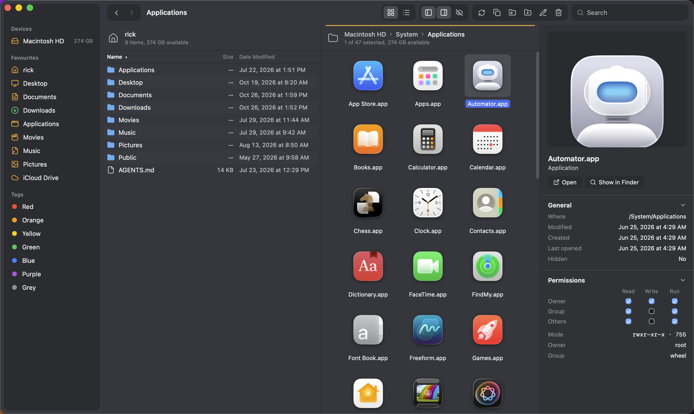

<div align="center">


# Patina

### A fast, keyboard-first dual-pane file manager for macOS.

**Two panes. Zero lag. No sandbox. Built in Rust.**

<p>
  
  
  
  
  
  
</p>

<p>
  <a href="#-features"><b>Features</b></a> ·
  <a href="#%EF%B8%8F-keyboard-shortcuts"><b>Shortcuts</b></a> ·
  <a href="#-quick-start"><b>Quick start</b></a> ·
  <a href="#-install-on-your-mac"><b>Install</b></a> ·
  <a href="#-how-it-works"><b>How it works</b></a> ·
  <a href="#-roadmap"><b>Roadmap</b></a>
</p>

```bash
npm install && npm run tauri dev
```

<br />



</div>

> [!NOTE]
> Patina runs outside the Mac App Store, so it isn't sandboxed and can browse your whole disk. No microphone, accessibility or screen-recording permissions are ever needed.

---

## ✨ Features

| | |
|---|---|
| 🪟 **Dual panes** | Two folders side by side. <kbd>Tab</kbd> flips between them. |
| ⚡ **Instant, even when huge** | Only visible rows are drawn, so 50,000-file folders scroll smoothly. |
| 📋 **Safe copy & move** | Clashes become `name copy`, `name copy 2`, like Finder. Nothing is ever overwritten. |
| 🍏 **APFS clones** | Copies on the same disk are instant and take no extra space. |
| 🔄 **Live refresh** | Panes update by themselves when files change on disk (FSEvents). |
| 🔤 **Natural sorting** | `file 2` before `file 10`; sort by name, size or date, folders first. |
| ⌨️ **Type to jump** | Start typing a name and the cursor jumps to it. |
| 🗑️ **Move to Bin** | Deletes go to the Bin, never straight to oblivion. |
| 🗂️ **Sidebar** | Drives with free space, Favourites, and Finder tags. Click a tag to list every file that has it. |
| 🖼️ **Icon view** | Quick Look thumbnails for photos, PDFs, videos and documents, and real app icons. |
| 👁️ **Preview panel** | Images, video, audio, text and code, plus size, dates and kind. |
| 🔐 **Permissions** | See and change read/write/run for owner, group and others. |
| 🔎 **Search** | Filter the current folder as you type. |
| 🌑 **Slate dark theme** | Soft greys, an inset sidebar, blue folders and orange accents. |

## ⌨️ Keyboard shortcuts

| Action | Keys |
|---|---|
| Switch pane | <kbd>Tab</kbd> |
| Move cursor / extend selection | <kbd>↑</kbd> <kbd>↓</kbd> / <kbd>⇧</kbd><kbd>↑</kbd> <kbd>⇧</kbd><kbd>↓</kbd> |
| Open file or folder | <kbd>Return</kbd> or <kbd>⌘</kbd><kbd>↓</kbd> |
| Enclosing folder | <kbd>⌫</kbd> or <kbd>⌘</kbd><kbd>↑</kbd> |
| Back / forward | <kbd>⌘</kbd><kbd>[</kbd> / <kbd>⌘</kbd><kbd>]</kbd> |
| Copy to other pane | <kbd>F5</kbd> |
| Move to other pane | <kbd>F6</kbd> |
| Rename | <kbd>F2</kbd> |
| New folder | <kbd>F7</kbd> or <kbd>⌘</kbd><kbd>⇧</kbd><kbd>N</kbd> |
| Move to Bin | <kbd>F8</kbd> or <kbd>⌘</kbd><kbd>⌫</kbd> |
| Show / hide hidden files | <kbd>⌘</kbd><kbd>⇧</kbd><kbd>.</kbd> |
| Reveal in Finder | <kbd>⌘</kbd><kbd>⌥</kbd><kbd>R</kbd> |
| Refresh | <kbd>⌘</kbd><kbd>R</kbd> |
| Select all / clear | <kbd>⌘</kbd><kbd>A</kbd> / <kbd>Esc</kbd> |
| List / icon view | <kbd>⌘</kbd><kbd>1</kbd> / <kbd>⌘</kbd><kbd>2</kbd> |
| Search this folder | <kbd>⌘</kbd><kbd>F</kbd> |
| Show / hide preview | <kbd>⌘</kbd><kbd>⇧</kbd><kbd>P</kbd> |
| Show / hide sidebar | <kbd>⌃</kbd><kbd>⌘</kbd><kbd>S</kbd> |

> [!TIP]
> On a MacBook keyboard, hold <kbd>fn</kbd> for the F-keys.

## 🚀 Quick start

You need [Rust](https://rustup.rs) and [Node.js](https://nodejs.org).

```bash
git clone git@github.com:DistinctZA/patina.git
cd patina
npm install
npm run tauri dev
```

Run the Rust tests for the file operations:

```bash
cd src-tauri && cargo test
```

## 📦 Install on your Mac

```bash
npm run tauri build -- --bundles app,dmg
```

Drag `src-tauri/target/release/bundle/macos/Patina.app` into **Applications**. The build is signed with the Developer ID certificate named in `src-tauri/tauri.conf.json`, so it opens without Gatekeeper warnings on this Mac.

> [!IMPORTANT]
> macOS asks once per protected folder (Desktop, Documents, Downloads, external drives). To skip those prompts entirely, add Patina under **System Settings → Privacy & Security → Full Disk Access**. Every build is signed with the same certificate, so the permission survives rebuilds.

<details>
<summary><b>Sharing Patina with other Macs (notarization)</b></summary>

<br />

A copy downloaded on another Mac must also be **notarized**, or Gatekeeper blocks it. Tauri notarizes during the build when these are set:

```bash
export APPLE_ID="you@example.com"
export APPLE_PASSWORD="app-specific-password"   # create at appleid.apple.com
export APPLE_TEAM_ID="Z8DX5X3H4R"
npm run tauri build -- --bundles app,dmg
```

</details>

## 🧠 How it works

```
┌───────────────────────────── Svelte 5 UI ─────────────────────────────┐
│   Left pane  ◄── Tab ──►  Right pane      virtual list · keyboard     │
└───────────────┬───────────────────────────────────────▲───────────────┘
                │ invoke (list_dir, copy_into, …)       │ dir-changed events
┌───────────────▼────────────────── Rust core ──────────┴───────────────┐
│   fs_ops.rs: list · sort · copy · move · rename   notify (FSEvents)   │
│   runs on blocking threads, so the window never freezes               │
└───────────────────────────────────────────────────────────────────────┘
```

| Path | What lives there |
|---|---|
| `src-tauri/src/fs_ops.rs` | Listing, natural sort, copy, move, rename, with tests |
| `src-tauri/src/lib.rs` | Tauri commands and the folder watcher |
| `src/lib/pane-state.svelte.ts` | One pane's folder, cursor, selection and history |
| `src-tauri/src/thumbs.rs` | Quick Look thumbnails and app icons, with a disk cache |
| `src/lib/Pane.svelte` | A pane: list and icon views, both virtualized |
| `src/lib/Sidebar.svelte` | Drives, favourites and tags |
| `src/lib/Preview.svelte` | Preview, file info and permissions |
| `src/routes/+page.svelte` | Layout, toolbar, search, shortcuts and dialogs |

## 🗺️ Roadmap

- [x] Dual-pane browsing, copy, move, rename, new folder, Bin
- [x] Live refresh, natural sort, hidden files, type-to-jump
- [x] Signed, unsandboxed macOS build
- [x] Sidebar with drives, favourites and tags
- [x] Icon view, preview panel, permissions editor, search
- [ ] Tabs in each pane
- [ ] Quick Open (fuzzy search across folders)
- [ ] Batch rename
- [ ] Folder compare & sync
- [ ] Full-screen Quick Look (<kbd>Space</kbd>)
- [ ] Column view
- [ ] Drag and drop with Finder
- [ ] Copy progress for large transfers

---

<div align="center">
  <sub>Made with 🦀 Rust.</sub>
</div>
