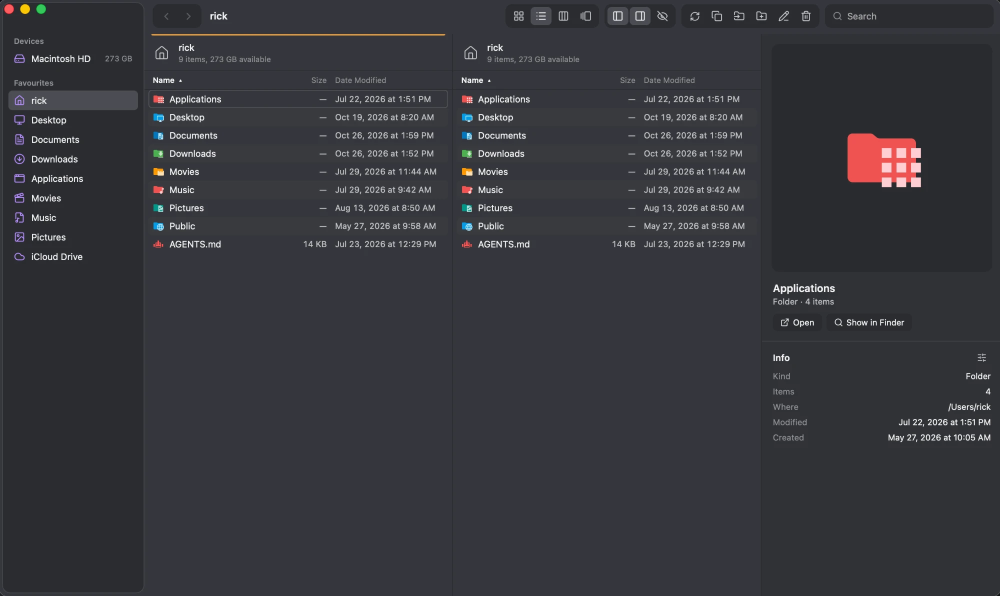
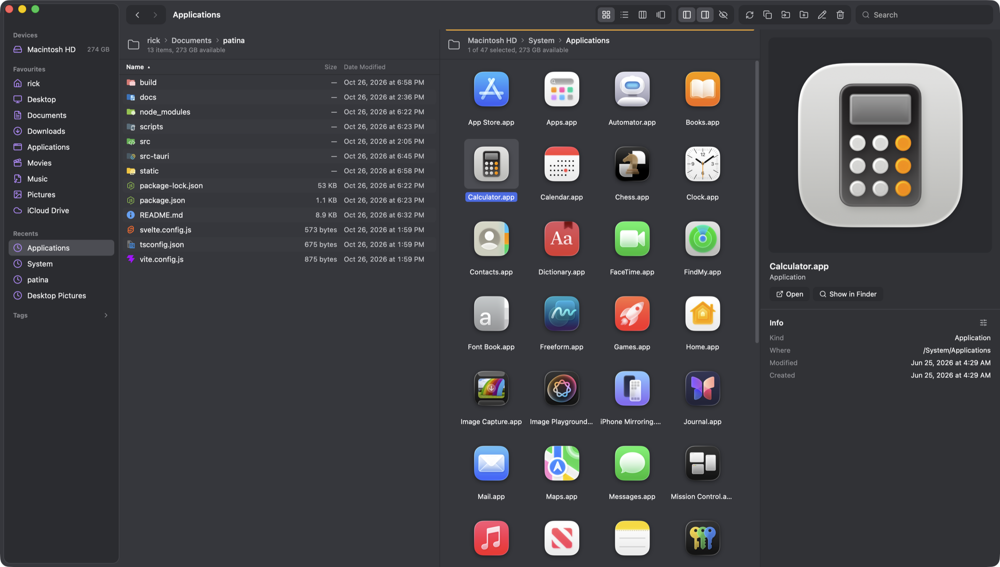

<div align="center">


# Patina

**A free, open-source dual-pane file manager for Mac.**<br />
A fast, keyboard-friendly Finder alternative, built with Rust.

<p>
  <a href="https://github.com/DistinctZA/patina/releases/latest"></a>
  <a href="LICENSE"></a>
  
  
</p>

<p>
  <a href="https://github.com/DistinctZA/patina/releases/latest"><b>Download for Mac</b></a> ·
  <a href="#features">Features</a> ·
  <a href="#build-from-source">Build from source</a>
</p>



</div>

Two folders side by side, with quick previews and familiar Mac file management. Free, open source, and private: no account, ads, or tracking.

## Download

**Apple silicon (M1 or later) · macOS 13 Ventura or later**

1. Get the `.dmg` from the [latest release](https://github.com/DistinctZA/patina/releases/latest).
2. Open it and drag **Patina** into **Applications**.
3. If macOS blocks the first launch, go to **System Settings → Privacy & Security → Open Anyway**.

New versions appear under **Update** at the bottom of the sidebar.

## Features

- **Two panes** with drag and drop, cut, copy and paste, including Finder support.
- **Four views:** Icons, List, Columns and Gallery, with resizable panels.
- **Quick previews** for images, video, audio, text and code, plus native Quick Look for files and documents.
- **Batch rename** with a live preview of your changes.
- **File transfers** with progress, cancellation and automatic names for conflicts. Deleted files go to the Bin.
- **A useful sidebar** for drives, favourites, recent folders and Finder tags.

<div align="center">

<br />
<sub>List view on the left, Icons view on the right, and the preview panel.</sub>
</div>

## Build from source

Requires Rust, Node.js 20.19+, and Apple's command line tools. Intel Macs can also build from source.

```bash
git clone https://github.com/DistinctZA/patina.git
cd patina
npm install
npm run tauri dev
```

## License

[MIT](LICENSE). File-type icons by [Material Icon Theme](https://github.com/material-extensions/vscode-material-icon-theme), also MIT. [Report a bug or suggest a feature](https://github.com/DistinctZA/patina/issues).
