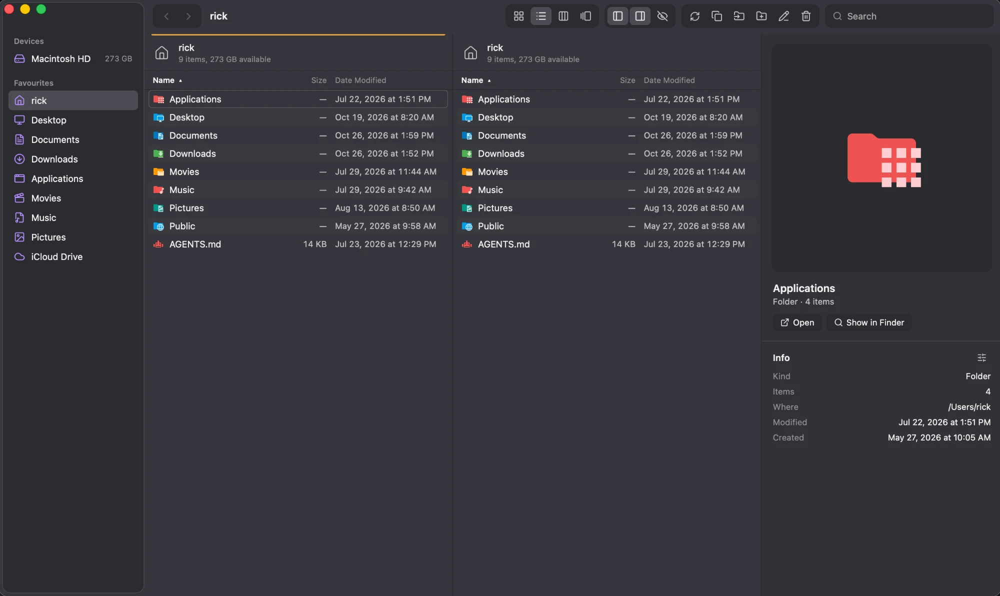
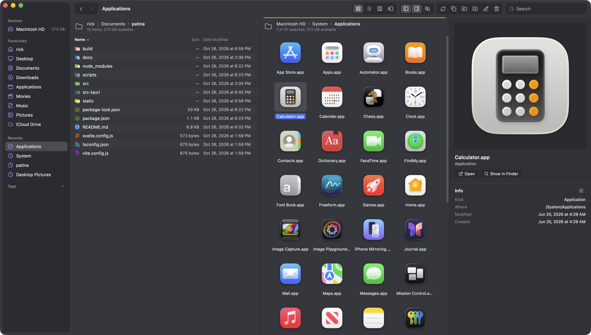

<div align="center">


# Patina

**A free, open-source dual-pane file manager for Mac.**<br />
A fast, keyboard-friendly Finder alternative, built with Rust.

<p>
  <a href="https://github.com/DistinctZA/patina/releases/latest"></a>
  <a href="LICENSE"></a>
  
  
</p>

<p>
  <a href="#install-with-homebrew"><b>Install with Homebrew</b></a> ·
  <a href="#features">Features</a> ·
  <a href="#build-from-source">Build from source</a>
</p>



</div>

Two folders side by side, with quick previews and familiar Mac file management. Free, open source, and private: no account, ads, or tracking.

## Install with Homebrew

Patina runs on **macOS 13 Ventura or later**. Homebrew installs the build tools and compiles Patina on your Mac. [Get Homebrew](https://brew.sh/)

```bash
brew install distinctza/tap/patina
patina
```

To update, run `brew update` followed by `brew upgrade distinctza/tap/patina`.

## Features

- **Two panes** with drag and drop, cut, copy and paste, including Finder support.
- **Four views:** Icons, List, Columns and Gallery, with resizable panels.
- **Quick previews** for images, video, audio, text and code, plus native Quick Look for files and documents.
- **Batch rename** with a live preview of your changes.
- **File transfers** with progress, cancellation and automatic names for conflicts. Deleted files go to the Bin.
- **A useful sidebar** for drives, favourites, recent folders and Finder tags.

<div align="center">

<br />
<sub>List view on the left, Icons view on the right, and the preview panel.</sub>
</div>

## Build from source

Install Apple's Command Line Tools with `xcode-select --install` if needed. You'll also need stable Rust and Node.js 22.12 or newer. [Get Rust](https://rustup.rs/) · [Get Node.js](https://nodejs.org/en/download)

```bash
git clone https://github.com/DistinctZA/patina.git
cd patina
npm ci
npm run build:app
open src-tauri/target/release/bundle/macos/Patina.app
```

You can drag the resulting `Patina.app` to Applications. For development with live reload, run `npm run tauri dev`.

## License

[MIT](LICENSE). File-type icons by [Material Icon Theme](https://github.com/material-extensions/vscode-material-icon-theme), also MIT. [Report a bug or suggest a feature](https://github.com/DistinctZA/patina/issues).
